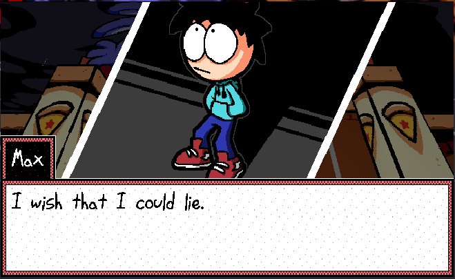
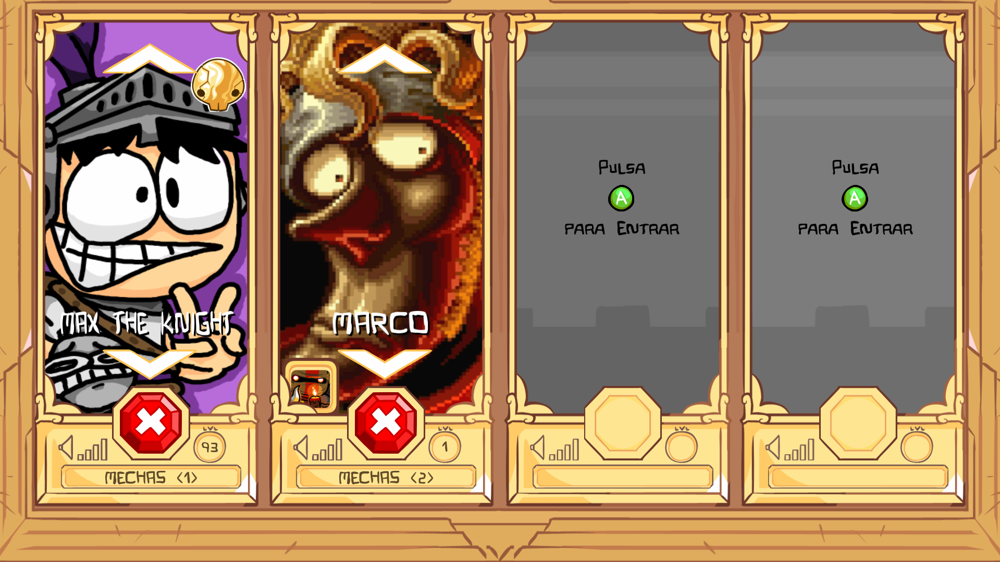
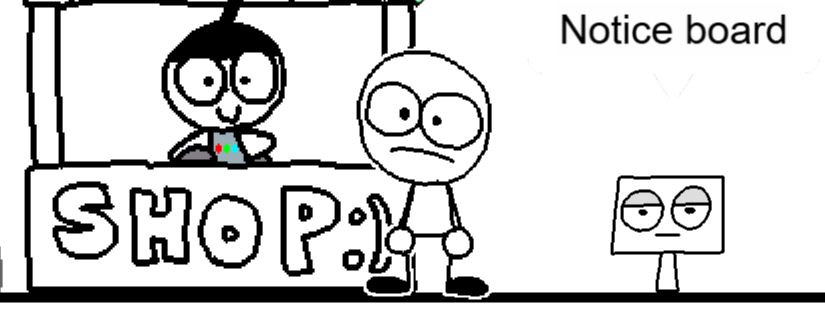

# 👋 Hola! Soc en Max Cuní

M'apassiona la tecnologia, dibuixar i els videojocs.

## 🤖 Qui soc?

Em dic **Max Cuní Momblant** i m'agrada explorar noves idees, experimentar amb la tecnologia i crear coses pel meu compte.

## 🎓 Què estudio i què vull aprendre?

Actualment estic estudiant un cicle de **Sistemes Microinformàtics i Xarxes (SMX)**. En un futur, m'agradaria cursar un cicle superior de desenvolupament d'aplicacions i videojocs per aprofundir en el món de la programació.

## 🛠️ Competències i tecnologies

Conec diferents llenguatges i formats que utilitzo per aprendre i desenvolupar petits projectes:

| **Web** | `HTML` | Elevat |
|:---|:---:|---:|
| **Scripting** | `Bash` · `Lua` | Bàsic |
| **Altres** | `Markdown` · `JSON` | Experimentant |

## 🚀 Projectes i pràctiques

M'agrada experimentar i posar a prova les meves habilitats a través de projectes personals, com ara:

- Modificació de fitxers i continguts de videojocs.
- Creació d'un joc experimental amb Roblox Studio.
- Desenvolupament de petits jocs amb eines com Julian's Editor.

  

Dos jocs modificats per mi i una creació original meva feta a Julian's Editor!

## 🎯 Interessos i objectius professionals

M'agrada inventar coses i compartir-les amb els altres. El meu objectiu és **crear el meu propi videojoc**, per oferir una experiència divertida a la gent i continuar aprenent i millorant les meves habilitats de programació.

### Informació de contacte i enllaços rellevants.

 
**Correu de contacte:** [maxcumo.95@gmail.com](mailto:maxcumo.95@gmail.com)
